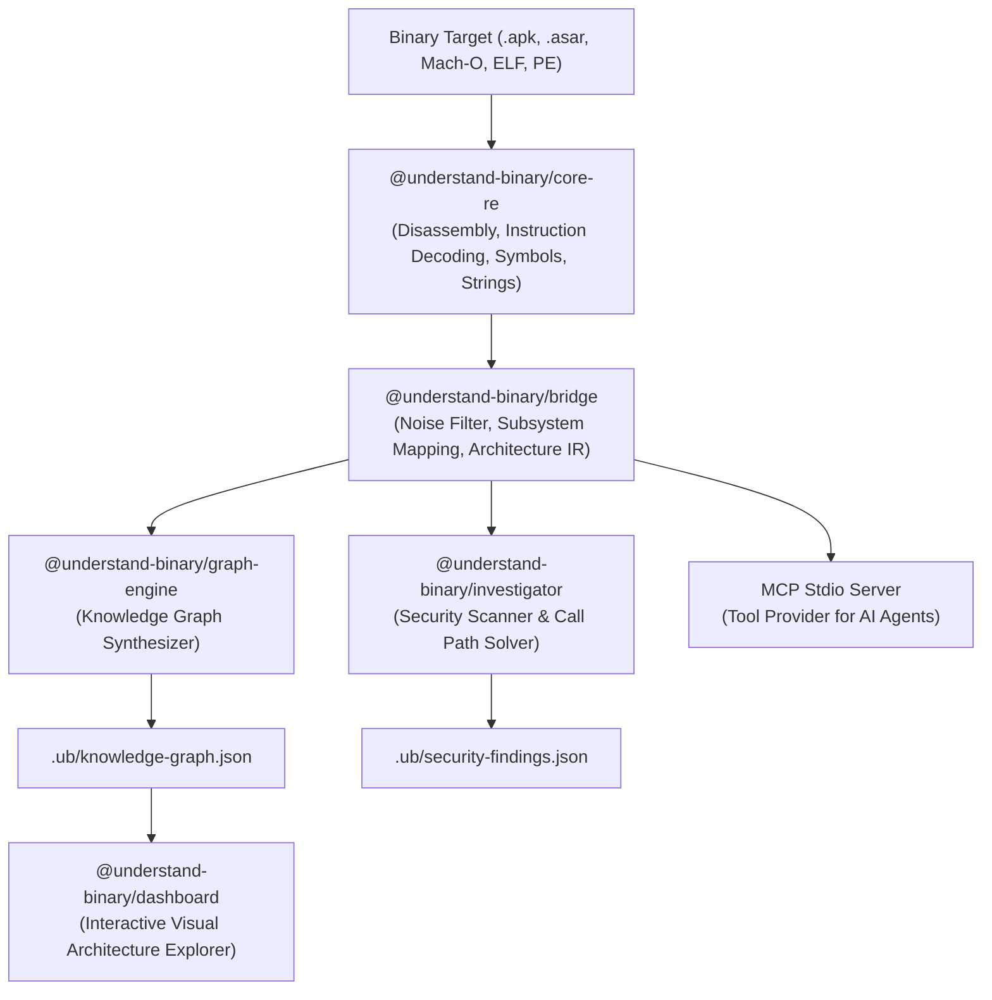

# Understand-Binary (`ub`)

> **Production-grade binary reverse engineering platform, architectural knowledge graph visualizer, and evidence-backed AI investigation engine.**

A unified platform combining the multi-target reverse engineering extraction engines of **[REA](https://github.com/morluto/rea)** with the interactive architecture visualization and semantic knowledge graph pipeline of **[Understand-Anything](https://github.com/Egonex-AI/Understand-Anything)**.

---

## 🚀 Key Capabilities

- **Multi-Target Ingestion & Instruction Disassembly**:
  - **Native Executables & Shared Libraries**: Mach-O (macOS), ELF (Linux), PE (Windows). Real instruction-level disassembly via `llvm-objdump` / `otool` parsing opcodes, branch targets (`call`, `bl`, `jmp`), and symbol stubs.
  - **Verified Call Graph & Cross-References**: Decodes instruction target addresses to build verified caller/callee trees and Xrefs, eliminating fabricated mock graphs.
  - **Electron & Node.js Applications**: Unpacks `.asar` packages, recovers source trees, maps IPC communication (`ipcRenderer.send`/`invoke` $\leftrightarrow$ `ipcMain.handle`/`on`), and external web/Node dependencies.
  - **Android Packages**: Decodes `.apk` files, DEX headers, manifest activities, and native `.so` dependencies.
- **Static Security Findings Framework**:
  - Automatically identifies dangerous memory functions (`strcpy`, `gets`, `sprintf`), command injection primitives (`system`, `execve`), unencrypted HTTP endpoints, and hardcoded secrets/keys.
- **Evidence-Backed AI Investigation Engine (`ub investigate`)**:
  - Autonomous multi-tool reasoning agent supporting **Google Gemini**, **Anthropic Claude**, **OpenAI**, and **local Ollama** (plus deterministic offline investigation without API keys).
  - Cites exact function addresses, instruction bytes, and proven facts without hallucination.
- **Model Context Protocol (MCP) Server (`ub mcp`)**:
  - Exposes REA-standard tools (`list_functions`, `get_disassembly`, `get_callers`, `get_callees`, `search_strings`, `find_call_path`) over stdio transport to Antigravity, Claude Code, and Cursor.
- **Execution Call Path Explorer**:
  - Built-in shortest-path solver (BFS/Dijkstra) to trace static execution paths between any two functions.
- **Interactive Dual-View Visualizer**:
  - **Macro View**: Interactive 2D force-directed architecture graph with subsystem filtering (UI, Core, Storage, Network, Security, IPC) and search.
  - **Micro View**: Real-time Technical Inspector with full disassembly instructions, opcodes, memory offsets, and caller/callee counts.
  - **Workspace Tabs**: Graph Explorer, Call Path Tracer, Security Findings, and AI Chat Drawer.

---

## 🛠️ Architecture



---

## 📦 Monorepo Structure

```text
understand-binary/
├── packages/
│   ├── core-re/        # Ingestion, format detection, disassembly, strings, IPC extraction
│   ├── bridge/         # Intermediate Representation (IR), noise filtering, subsystem clustering
│   ├── graph-engine/   # Understand-Anything schema generator and graph synthesizer
│   ├── investigator/   # AI investigation engine, security scanner, call path solver, MCP server
│   ├── dashboard/      # Modern React 19 + Vite + Tailwind interactive exploration dashboard
│   └── cli/            # `ub` command line tool (analyze, serve, mcp, investigate commands)
├── docs/
│   ├── IMPLEMENTATION_AUDIT.md
│   ├── REA_GAP_ANALYSIS.md
│   ├── ARCHITECTURE.md
│   ├── SECURITY.md
│   └── BENCHMARKS.md
├── pnpm-workspace.yaml
├── package.json
└── README.md
```

---

## ⚡ Quick Start

### 1. Install & Build

```bash
# Clone and enter the repository
cd ~/understand-binary

# Install dependencies across all packages
pnpm install

# Build all packages
pnpm build

# Run automated test suite
pnpm test
```

### 2. Analyze a Binary

```bash
# Analyze any native executable or application package
ub analyze /bin/ls --dashboard
```

Or analyze an Electron package or APK:
```bash
ub analyze ./app.asar -o .ub
```

### 3. Launch the Interactive Dashboard

```bash
ub serve .ub -p 3000
```
Open **`http://localhost:3000`** in your browser to explore the architecture interactively.

### 4. Run an AI Investigation

Ask any technical question about the binary directly from your terminal:

```bash
ub investigate "Where is network or security handled?" -d .ub
```

### 5. Run as Model Context Protocol (MCP) Server

Connect your favorite AI coding agent (Antigravity, Claude Code, Cursor) to Understand-Binary:

```bash
ub mcp .ub
```

---

## 💻 CLI Command Reference

| Command | Description |
| :--- | :--- |
| `ub analyze <target> [--dashboard] [-o .ub]` | Ingests, disassembles, normalizes, scans security findings, and builds knowledge graph. |
| `ub serve [dir] [-p 3000]` | Starts the local visualization dashboard with Graph, Call Path, Findings, and AI Chat tabs. |
| `ub investigate <question> [-d .ub]` | Performs an evidence-backed technical investigation citing verified addresses and facts. |
| `ub mcp [dir]` | Launches the MCP stdio server exposing analysis tools to external agents. |

---

## 📄 Output Artifacts (`.ub/`)

- **`knowledge-graph.json`**: Understand-Anything compliant schema powering visual dashboards.
- **`architecture-ir.json`**: Normalized intermediate representation with instruction streams, basic blocks, and caller/callee trees.
- **`security-findings.json`**: Categorized security findings with severity, confidence, and remediation.

---

## 📜 License

MIT License.
