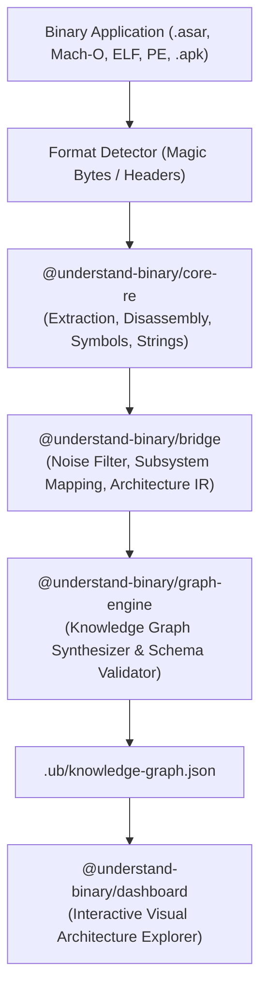

# Understand-Binary (`ub`)

> **Reverse engineer binary applications, reconstruct their software architecture, and visualize them as interactive knowledge graphs.**

A unified platform combining the multi-target reverse engineering extraction engines of **[REA](https://github.com/morluto/rea)** with the interactive architecture visualization and semantic knowledge graph pipeline of **[Understand-Anything](https://github.com/Egonex-AI/Understand-Anything)**.

---

## 🚀 Key Capabilities

- **Multi-Target Ingestion**:
  - **Native Executables & Shared Libraries**: Mach-O (macOS), ELF (Linux), PE (Windows). Extracts symbol tables, imported frameworks, dynamic libraries, and caller/callee xrefs.
  - **Electron & Node.js Applications**: `.asar` packages and JavaScript bundles. Recovers source hierarchies, maps IPC channels (`ipcRenderer.send`/`invoke` $\leftrightarrow$ `ipcMain.handle`/`on`), and external web/Node dependencies.
  - **Android Packages**: `.apk` and DEX binaries. Discovers activities, background services, intent communications, and native `.so` dependencies.
- **Noise Reduction & Normalization**:
  - Automatically filters compiler intrinsics, runtime trampolines, and linker boilerplate (`_start`, `__libc_csu_init`, `dyld_stub_binder`).
  - Clusters raw symbols into functional architectural **Subsystems** (UI, Core Logic, Cryptography/Security, Network, Storage, IPC).
- **Interactive Dual-View Visualizer**:
  - **Macro View**: Interactive 2D/3D force-directed node-edge architecture graph with zoom, pan, and search.
  - **Micro View**: Real-time Technical Inspector with decompiled pseudo-code, memory offsets, callers/callees, and exported symbols.
- **Understand-Anything Standard Schema**:
  - Outputs standard `knowledge-graph.json` compatible with all Understand-Anything viewers and dashboards.

---

## 🛠️ Architecture



---

## 📦 Monorepo Structure

```text
understand-binary/
├── packages/
│   ├── core-re/        # Ingestion, format detection, disassembly, strings, IPC extraction
│   ├── bridge/         # Intermediate Representation (IR), noise filtering, subsystem clustering
│   ├── graph-engine/   # Understand-Anything schema generator and graph synthesizer
│   ├── dashboard/      # Modern React 19 + Vite + Tailwind interactive exploration dashboard
│   └── cli/            # `ub` command line tool (analyze & serve commands)
├── pnpm-workspace.yaml
├── package.json
└── README.md
```

---

## ⚡ Quick Start

### 1. Install & Build

```bash
# Clone and enter the repository
cd ~/understand-binary

# Install dependencies across all packages
pnpm install

# Build all packages
pnpm build
```

### 2. Analyze a Binary

```bash
# Analyze any native executable or application package
node packages/cli/dist/index.js analyze /bin/ls --dashboard
```

Or analyze an Electron package or APK:
```bash
node packages/cli/dist/index.js analyze ./app.asar -o .ub
```

### 3. Launch the Interactive Dashboard

```bash
node packages/cli/dist/index.js serve .ub -p 3000
```
Open **`http://localhost:3000`** in your browser to explore the architecture interactively.

---

## 💻 CLI Commands

### `ub analyze <target>`

Analyze a binary executable or application bundle.

| Option | Default | Description |
| :--- | :--- | :--- |
| `-o, --output <dir>` | `.ub` | Output directory for `knowledge-graph.json` |
| `--dashboard` | `false` | Automatically launch the visualization server after analysis |
| `-p, --port <port>` | `3000` | Port for the dashboard server |

### `ub serve [dir]`

Start the visualization server for a previously generated knowledge graph.

```bash
ub serve .ub --port 3000
```

---

## 📄 Output Schema (`knowledge-graph.json`)

The output graph follows the Understand-Anything schema:

- **`project`**: Metadata, target binary format, architecture, and analysis timestamp.
- **`nodes`**:
  - `service`: High-level architectural subsystems (UI, Core, Network, Storage, Security, IPC).
  - `module`: Extracted libraries, files, or DEX packages.
  - `function`: Decompiled routines, symbols, and entrypoints.
  - `endpoint`: IPC channels, system APIs, and external interfaces.
- **`edges`**: `contains`, `calls`, `routes` (IPC), `imports`.
- **`layers`**: Functional groupings for toggling views.
- **`tour`**: Guided walkthrough of entrypoints, subsystems, and external surfaces.

---

## 📜 License

MIT License.
