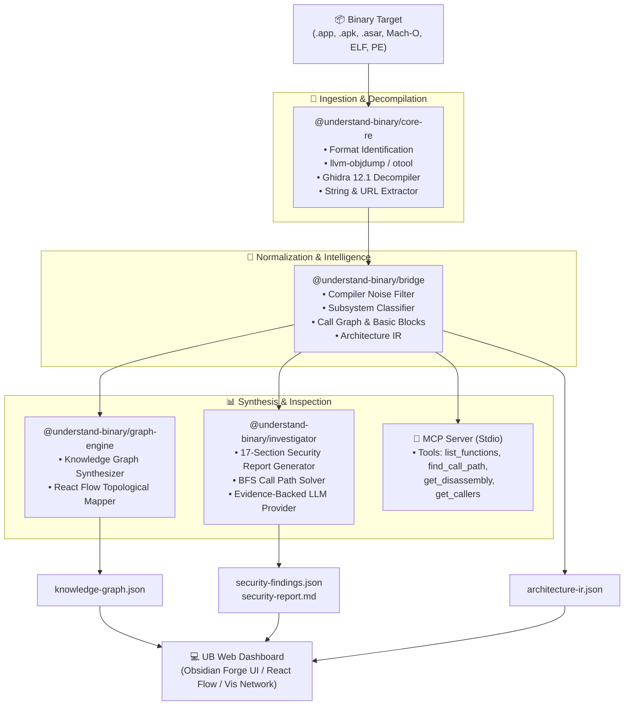

# 🛡️ UB: Binary Architecture Intelligence & Security Platform

<div align="center">

[](https://opensource.org/licenses/MIT)
[](https://www.typescriptlang.org/)
[](https://nodejs.org/)
[](https://modelcontextprotocol.io/)
[](https://ghidra-sre.org/)
[](#-interactive-web-dashboard)

**UB** is an enterprise-grade binary reverse engineering platform, architectural knowledge graph visualizer, and evidence-backed AI investigation engine.

*Bridging deep decompilation telemetry from **[REA](https://github.com/morluto/rea)** and **Ghidra 12.1** with the interactive visual architecture canvas of **[Understand-Anything](https://github.com/Egonex-AI/Understand-Anything)**.*

[Key Capabilities](#-key-capabilities) • [Hero Example: Balatro](#-hero-example-balatroapp) • [Architecture](#-system-architecture) • [Quick Start](#-quick-start) • [CLI Commands](#-cli-command-reference) • [MCP Server](#-model-context-protocol-mcp)

</div>

---

## 🌟 Executive Overview

Modern binaries—whether native Mach-O/ELF executables, Electron desktop bundles, or Android packages—are black boxes. Traditional disassemblers drown reverse engineers in millions of unorganized assembly instructions, while LLMs frequently hallucinate function names, addresses, and call relationships.

**UB solves this by establishing verified fact pipelines:**
1. **Deterministic Static Extraction**: Ingests binaries, unpacks runtime packages, parses Mach-O/ELF/PE headers, and disassembles instructions down to opcodes and branch targets.
2. **Intermediate Representation (IR)**: Normalizes symbols, filters compiler runtime noise, infers architectural subsystems (UI, Core, Storage, IPC, Crypto), and maps cross-references (Xrefs).
3. **Dual-Engine Interactive Visualizer**: Renders both hierarchical **React Flow** architecture topologies and high-density **ForceAtlas2** physics networks styled in the **Obsidian Forge** design system.
4. **Publication-Grade Security Assessment**: Automatically synthesizes comprehensive 17-section security reports identifying CVE vectors, dangerous memory primitives, and attack surfaces.
5. **Zero-Hallucination AI Copilot**: Multi-turn reasoning agent and MCP stdio server backed by verified evidence citations and function addresses.

---

## 🚀 Key Capabilities

### 🔍 1. Multi-Target Ingestion & Decompilation
- **Native Executables & Universal Binaries**: Full support for macOS Mach-O (including multi-slice FAT `arm64` / `x86_64`), Linux ELF, and Windows PE.
- **Ghidra 12.1 Headless Decompiler**: Automatically generates pseudo-C decompilation for high-complexity functions when available.
- **Electron & Node.js Applications**: Unpacks `.asar` archives, recovers complete JavaScript/TypeScript source trees, maps inter-process communication (`ipcRenderer` $\leftrightarrow$ `ipcMain`), and evaluates native Node addons (`.node`).
- **Android Packages (APK)**: Unpacks DEX bytecode, Android manifests, activities, intent filters, and embedded native libraries (`.so`).

### 🛡️ 2. Publication-Grade Security Assessment
- **Automated 17-Section Reports**: Generates formal markdown security audits covering Threat Models, Attack Surfaces, Unsafe C-Strings, ASLR/DEP/Codesign status, and Remediation Strategies.
- **Dangerous Primitive Detection**: Scans for buffer-overflow sinks (`strcpy`, `sprintf`, `gets`), command-injection gates (`system`, `popen`, `execve`), and weak cryptography.
- **Cleartext Secret Hunting**: Scans string tables for hardcoded API keys, bearer tokens, private endpoints, and unencrypted HTTP communications.

### 🪐 3. Interactive Web Dashboard (Stitch "Obsidian Forge")
- **⚡ Nodes Flow Canvas**: React Flow graph powered by Understand-Anything layout algorithms (Elk/Dagre), organizing code into clean architectural clusters.
- **🪐 Force Network**: Force-directed graph with real-time subsystem filters, search, and dynamic zoom/pan physics.
- **📋 Security Report Viewer**: In-browser rendered viewer with one-click `.md` download.
- **🔍 Call Path Tracer**: BFS/Dijkstra shortest-path solver tracing static call paths between any two symbols.
- **💬 AI Copilot**: In-browser LLM chat drawer supporting client-side credentials (`localStorage`) with live model fetching for **Gemini**, **Claude**, **OpenAI**, and **Ollama**.

### 🔌 4. Model Context Protocol (MCP) Server
- Turn-key stdio server compatible with **Antigravity**, **Claude Code**, and **Cursor**.
- Exposes standard tools: `list_functions`, `get_disassembly`, `get_callers`, `get_callees`, `search_strings`, `find_call_path`, and `get_security_findings`.

---

## 🎮 Hero Example: Balatro.app

UB has been verified on large-scale commercial binaries. Below is the real-world extraction telemetry from **Balatro.app** (macOS Universal Fat Binary - `arm64` / `x86_64` with LÖVE2D runtime and embedded Lua engine):

```text
🔍 [UB] Ingesting and analyzing target: /Applications/Balatro.app

[1/4] Running extraction, disassembly & instruction decoding...
      Format: MACOS_APP (universal-fat: arm64/x86_64) | Functions: 779 | Strings: 500
[2/4] Normalizing symbols, instruction xrefs and inferring subsystems...
      Subsystems: 4 | Components: 62 | Relationships: 29
[3/4] Scanning for security findings and unsafe primitives...
      Security Findings: 11
[4/4] Synthesizing Understand-Anything knowledge graph...

✓ Analysis complete in 10.96s!
  Artifacts saved to: ~/.ub
  Nodes: 845 | Edges: 870 | Findings: 11
```

---

## 🏗️ System Architecture



---

## 📦 Monorepo Packages

| Package | Purpose | Technology |
| :--- | :--- | :--- |
| **`packages/core-re`** | Target ingestion, Mach-O/ELF/PE parsing, Ghidra decompilation, Electron/APK unpackers | TypeScript, LLVM, Asar, Ghidra Headless |
| **`packages/bridge`** | Architecture IR schema, compiler noise filtering, subsystem classification | TypeScript, Zod |
| **`packages/graph-engine`** | Generates Understand-Anything knowledge graphs from Architecture IR | TypeScript |
| **`packages/investigator`** | Static security scanner, publication-grade report generator, AI investigation engine, MCP server | TypeScript, Model Context Protocol SDK |
| **`packages/dashboard`** | React Flow architecture workspace | React 19, Vite, Tailwind CSS, XYFlow |
| **`packages/cli`** | High-performance CLI interface and unified dashboard web server | Node.js, TypeScript |

---

## ⚡ Quick Start

### 📋 Prerequisites
- **Node.js**: `>= 20.0.0`
- **pnpm**: `>= 9.0.0`
- **Optional**: LLVM (`llvm-objdump` / `llvm-nm`) or Ghidra (`ghidraDecompiler` on `$PATH`) for decompilation

### 1️⃣ Clone & Build

```bash
# Clone the repository
git clone https://github.com/devanshvpurohit/understand-binary.git
cd understand-binary

# Install dependencies across all workspace packages
pnpm install

# Build all TypeScript packages
pnpm build

# Run monorepo test suite (100% pass)
pnpm test
```

### 2️⃣ Analyze a Binary

```bash
# Analyze any macOS application, native binary, or package
ub analyze /Applications/Balatro.app --dashboard

# Or analyze an Electron package or Linux ELF binary
ub analyze ./resources/app.asar -o .ub
```

### 3️⃣ Launch the Web Dashboard

```bash
# Start the UB dashboard on port 3000
ub serve .ub --port 3000
```
Open **`http://localhost:3000`** in your browser to explore the binary architecture.

### 4️⃣ Generate a Security Assessment Report

```bash
# Generate a full 17-section publication-grade security report
ub report /Applications/Balatro.app -o ./SECURITY_REPORT.md
```

### 5️⃣ Evidence-Backed AI Investigation

Ask any technical question from your terminal without hallucination:

```bash
ub investigate "Explain the initialization flow and list unencrypted endpoints" -d .ub
```

---

## 💻 CLI Command Reference

```text
Usage: ub <command> [options]

Commands:
  analyze <target>      Analyze a binary executable or application package
  serve [dir]           Start the interactive web dashboard
  report <target>       Generate a publication-grade 17-section security assessment report
  investigate <q>       Run an evidence-backed technical AI investigation
  mcp [dir]             Start the Model Context Protocol (MCP) stdio server
```

### Options Breakdown

| Command | Option | Description | Default |
| :--- | :--- | :--- | :--- |
| `analyze` | `-o, --output <dir>` | Directory to store generated `.ub` artifacts | `.ub` |
| `analyze` | `-d, --dashboard` | Automatically start dashboard after analysis completes | `false` |
| `analyze` | `-f, --force` | Overwrite existing output directory without prompting | `false` |
| `serve` | `-p, --port <number>` | Port for the local HTTP server | `3000` |
| `report` | `-o, --output <file>` | Path to save the generated markdown assessment report | `stdout` |
| `investigate` | `-d, --dir <dir>` | Path to analyzed `.ub` artifacts directory | `.ub` |
| `mcp` | `[dir]` | Path to analyzed `.ub` artifacts directory | `.ub` |

---

## 🔌 Model Context Protocol (MCP)

UB provides native MCP server integration. Add UB to your agent configuration:

### 🤖 Antigravity / Claude Desktop / Cursor (`claude_desktop_config.json`)

```json
{
  "mcpServers": {
    "understand-binary": {
      "command": "node",
      "args": [
        "/path/to/understand-binary/packages/cli/dist/index.js",
        "mcp",
        "/path/to/.ub"
      ]
    }
  }
}
```

### Available MCP Tools
- 📋 **`list_functions`**: List reconstructed functions with memory offsets and complexity scores.
- 🔬 **`get_disassembly`**: Retrieve instruction disassembly and basic block structures for any symbol.
- 📞 **`get_callers` / `get_callees`**: Inspect verified static call graph relationships.
- 🔤 **`search_strings`**: Search binary string tables and static read-only data.
- 🛣️ **`find_call_path`**: Trace verified shortest execution path between two addresses.
- 🛡️ **`get_security_findings`**: Query automated static security findings and vulnerability classifications.

---

## 📁 Output Artifacts (`.ub/`)

When UB analyzes a target, it generates transparent, auditable artifacts:

| Artifact | Size (Balatro) | Format | Description |
| :--- | :--- | :--- | :--- |
| **`knowledge-graph.json`** | ~696 KB | JSON | Full Understand-Anything schema with nodes, edges, and subsystem layers |
| **`architecture-ir.json`** | ~492 KB | JSON | Normalized intermediate representation with instructions, basic blocks, and Xrefs |
| **`security-findings.json`**| ~6 KB | JSON | Categorized vulnerabilities with severity, confidence, and remediation |
| **`security-report.md`** | ~54 KB | Markdown | 17-section publication-grade security assessment report |

---

## 🤝 Contributing

Contributions to UB are welcome!
1. Fork the repository.
2. Create your feature branch (`git checkout -b feature/amazing-engine`).
3. Commit your changes (`git commit -m 'feat: add PE authenticode signature verification'`).
4. Ensure all tests pass (`pnpm test`).
5. Open a Pull Request.

---

## 📜 License

Distributed under the **MIT License**. See `LICENSE` for details.
